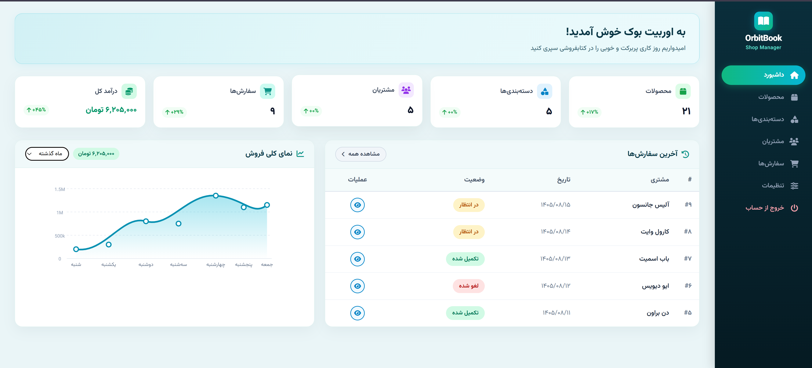
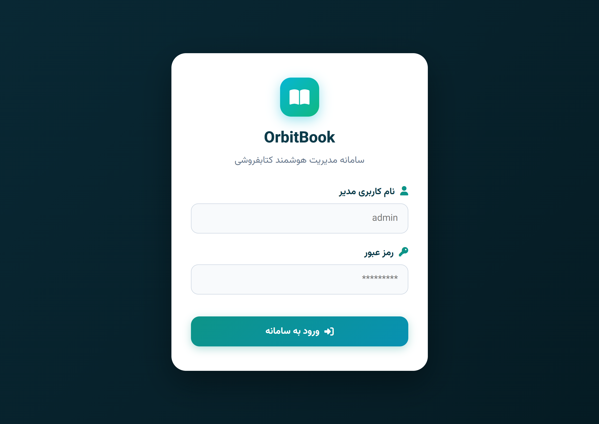
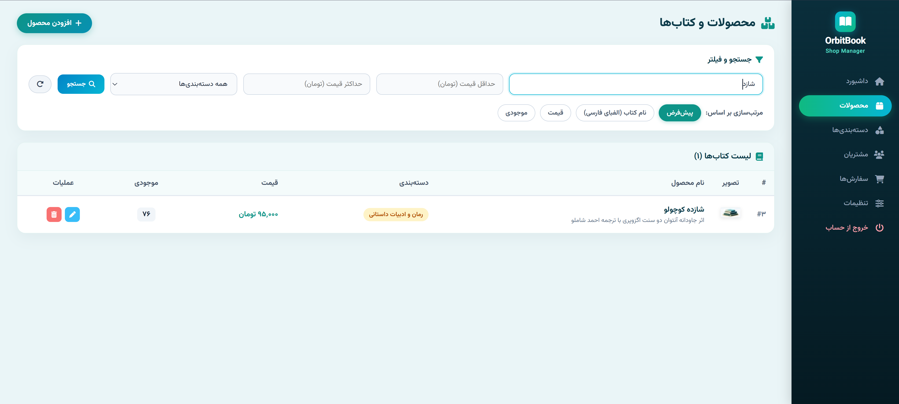
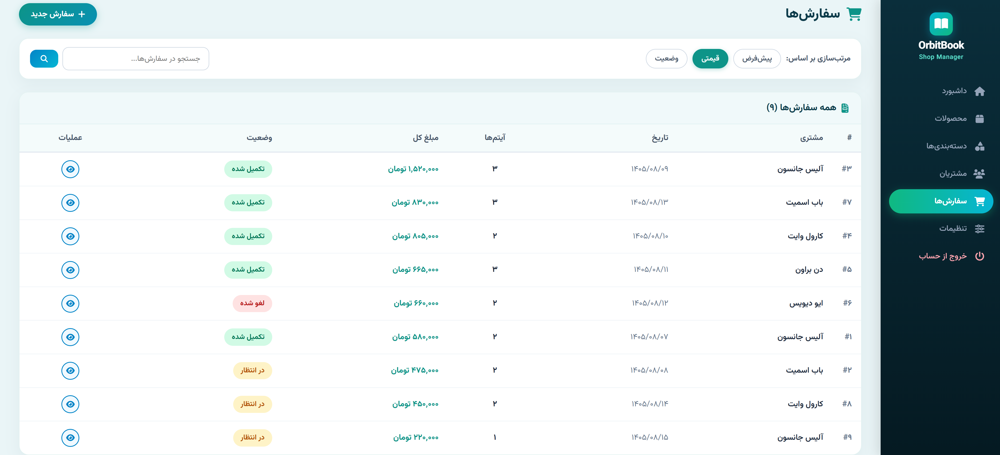
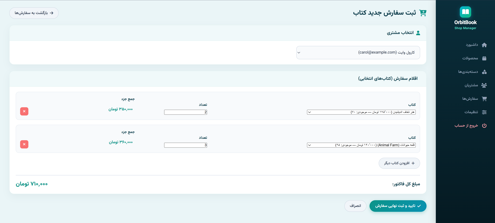
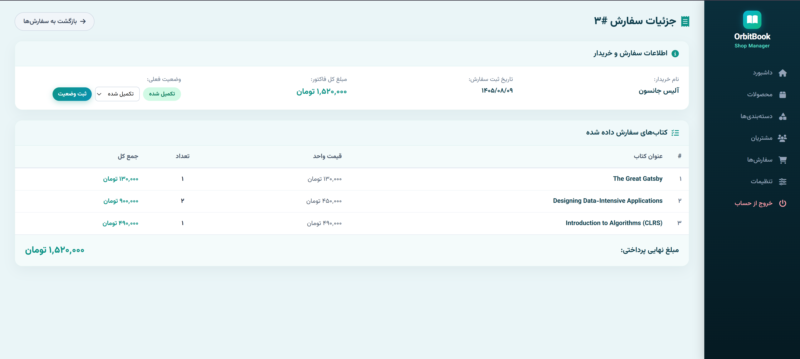
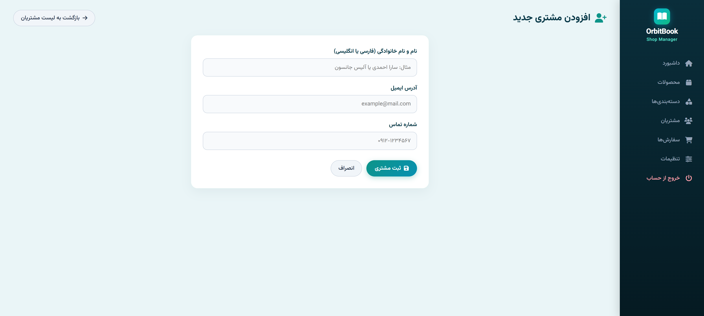
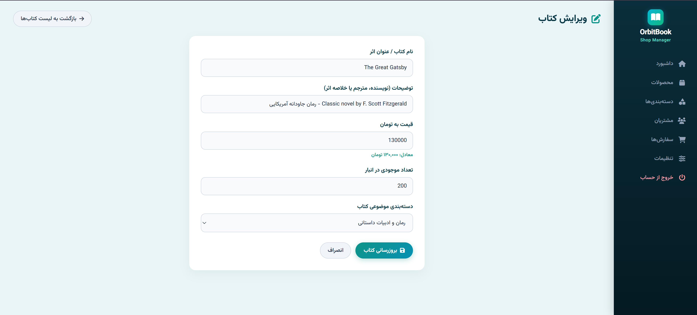
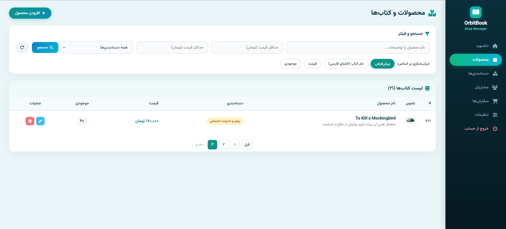

# 📚 OrbitBook — سامانه جامع مدیریت کتابفروشی (Full-Stack)

یک پروژه فول‌استک مدرن و با معماری مجزا (**Decoupled**) شامل **FastAPI** در بخش بک‌اند و **Vue 3 SPA** در بخش فرانت‌اند، با امکان استقرار یکپارچه به عنوان یک **«سرویس واحد (Single Service)»** روی پلتفرم ابری **Render.com**.

---

> [!IMPORTANT]
> ### 🚀 مشاهده نسخه آنلاین (Live Demo)
> **آدرس دمو:** [https://book-store-qqh0.onrender.com/](https://book-store-qqh0.onrender.com/)
> 
> ⚠️ **نکات مهم پیش از مشاهده:**
> 1. **نیاز به ابزار دور زدن تحریم (VPN):** با توجه به محدودیت‌ها و فیلترینگ دامنه‌های پلتفرم Render در ایران، لطفاً جهت باز شدن صحیح سرویس و است‌ها حتماً از **VPN** استفاده نمایید.
> 2. **زمان بارگذاری اولیه (Cold Start):** به علت استفاده از پلن رایگان (Free Tier) سرویس Render، سرور در زمان عدم استفاده به حالت Sleep می‌رود. در نتیجه اولین درخواست ممکن است بین **۳۰ الی ۴۰ ثانیه** زمان ببرد. پس از بارگذاری اولیه، سرعت پاسخ‌دهی به حالت عادی بازمی‌گردد.

---

## 🔑 اطلاعات حساب‌های کاربری پیش‌فرض (Credentials)

جهت تست و ورود به سامانه، از اطلاعات کاربری زیر استفاده کنید:

| نقش کاربری | نام کاربری (Username) | رمز عبور (Password) | سطح دسترسی |
| :--- | :---: | :---: | :--- |
| **مدیر سیستم (Admin)** | `admin` | `admin123` | دسترسی کامل به پنل مدیریت، ویرایش کتاب‌ها، تغییر وضعیت سفارش‌ها و گزارشات |

---

## 📸 گالری تصاویر محیط برنامه (Screenshots)

| عنوان صفحه / قابلیت | تصویر محیط برنامه |
| :--- | :--- |
| **داشبورد مدیریت و تحلیل فروش**<br>نمایش شاخص‌های کلیدی، نمودار تعاملی فروش هفتگی و آخرین سفارش‌ها |  |
| **صفحه ورود امن مدیر (Login)**<br>احراز هویت سشن‌محور با اعتبارسنجی امن |  |
| **مدیریت کتاب‌ها و فیلتر پیشرفته**<br>فیلتر بر اساس دسته‌بندی موضوعی، بازه قیمت به تومان و نام کتاب |  |
| **مرتب‌سازی بر اساس الفبای فارسی**<br>الگوریتم مرتب‌سازی دقیق حروف الفبای فارسی (آ تا ی) |  |
| **ثبت سفارش جدید کتاب**<br>انتخاب خریدار، افزودن اقلام مختلف و محاسبه آنلاین مبلغ کل فاکتور |  |
| **فاکتور جزئیات و تغییر وضعیت سفارش**<br>بروزرسانی وضعیت سفارش (تکمیل شده، در انتظار، لغو شده) |  |
| **فرم افزودن کتاب و دسته‌بندی جدید**<br>ثبت اثر جدید با فیلدهای عنوان، قیمت به تومان، موجودی و توضیحات |  |
| **فرم ویرایش و به‌روزرسانی اطلاعات**<br>ویرایش مشخصات کتاب، خریدار و دسته‌بندی با اعتبارسنجی خودکار |  |
| **صفحه‌بندی مدرن جداول (Pagination)**<br>ناوبری سریع بین صفحات با کنترل تعداد نتایج در هر صفحه |  |

---

## ✨ ویژگی‌ها و قابلیت‌های برجسته

1. **معماری تک‌سرویسی (Single-Service Deployment):**
   - فرانت‌اند کامپایل‌شده (SPA) مستقیماً توسط FastAPI سرو می‌شود؛ در نتیجه نیازی به دو دامین مجزا نبوده و مشکلات تداخل **CORS** و **Cookie Blocking** به طور کامل ریشه‌کن شده است.
2. **مرتب‌سازی اختصاصی الفبای فارسی (`persian_sort_key`):**
   - پیاده‌سازی الگوریتم ۳۲ حرفی زبان فارسی برای سورت دقیق اسامی مشتریان، عناوین کتاب‌ها و دسته‌بندی‌ها به جای سورت ناقص کد اسکی پیش‌فرض دیتابیس‌ها.
3. **قیمت‌گذاری به تومان و تاریخ شمسی:**
   - نمایش خودکار تمامی مبالغ با جداکننده سه‌رقمی و پسوند «تومان».
   - تبدیل خودکار تاریخ‌های میلادی میلادی به تاریخ هجری خورشیدی (Jalali).
4. **استیت ماشین هوشمند سفارش‌ها:**
   - ذخیره‌سازی داده‌های وضعیت با کدهای استاندارد بین‌المللی (`pending`, `completed`, `cancelled`) در پایگاه داده SQLite و نگاشت دوطرفه فارسی/انگلیسی در لایه API و فرانت‌اند.
5. **مکانیزم راه‌اندازی و Seeding خودکار:**
   - در زمان استارت‌آپ اولیه در صورتی که دیتابیس خالی باشد، داده‌های اولیه کتابفروشی به صورت اتوماتیک ساخته و تزریق می‌شوند.
6. **طراحی بصری چشم‌نواز با تایپوگرافی فارسی:**
   - سایدبار با شیب‌رنگ تیره و المان‌های سه‌بعدی کتاب، فونت استاندارد **وزیرمتن (Vazirmatn)** و تم رنگی Ice Mint.

---

## 🛠 تکنولوژی‌های استفاده‌شده (Tech Stack)

### بک‌اند (Backend)
- **FastAPI:** فریم‌ورک سریع و مدرن پایتون برای ساخت REST API.
- **Uvicorn:** سرور قدرتمند و فوق‌سریع ASGI.
- **SQLAlchemy:** ابزار قدرتمند ORM جهت اتصال به پایگاه‌داده.
- **SQLite:** پایگاه‌داده رابطه‌ای سبک و قابل حمل.
- **Pydantic v2:** اعتبارسنجی دقیق داده‌ها و اسکیمای ریکوئست/ریسپانس‌ها.
- **Starlette Sessions:** مدیریت احراز هویت سشن‌محور مبتنی بر کوکی رمزنگاری‌شده.

### فرانت‌اند (Frontend)
- **Vue 3:** فریم‌ورک واکنشی جاوااسکریپت (Options & Composition API).
- **Vue Router 4:** روتینگ بدون رفرش (Single Page Application) با گارد احراز هویت.
- **Vite 5:** بیلد تولز پرسرعت فرانت‌اند.
- **Vazirmatn:** تایپوگرافی خوانا و مدرن فارسی.
- **Font Awesome 6:** مجموعه آیکون‌های وکتور استاندارد.

### دواپس و استقرار (DevOps)
- **Docker:** بیلد چندمرحله‌ای (Multi-stage) با ترکیب محیط Node.js و Python Slim جهت به حداقل رساندن حجم ایمیج نهایی.
- **Render.com:** پلتفرم استقرار ابری با استفاده از `render.yaml` (منطقه فرانکفورت برای پینگ کمینه).

---

## 📁 ساختار درختی پروژه (Project Tree)

```text
item_management_fullstack/
├── Dockerfile                  # فایل بیلد چندمرحله‌ای داکر برای استقرار
├── .dockerignore               # لیست فایل‌های مستثنی‌شده از کانتینر
├── render.yaml                 # کانفیگ Blueprint سرویس ابری در Render (Frankfurt)
├── .gitignore                  # قوانین گیت همراه با استثنای نگهداری shop.db
├── start.py                    # اسکریپت رانر پایتون برای اجرای همزمان فرانت و بک
├── README.md                   # مستندات جامع پروژه
│
├── backend/                    # کدهای لایه بک‌اند (FastAPI)
│   ├── requirements.txt        # پکیج‌های پایتون مورد نیاز
│   ├── seed.py                 # اسکریپت پر کردن داده‌های تستی کتابفروشی
│   ├── shop.db                 # فایل دیتابیس SQLite
│   └── app/
│       ├── main.py             # فایل اصلی سرور، استارت‌آپ و روت‌های SPA Fallback
│       ├── database.py         # کانکشن دیتابیس با مسیردهی مطلق
│       ├── utils.py            # تابع اختصاصی مرتب‌سازی الفبای فارسی (persian_sort_key)
│       ├── models/             # مدل‌های دیتابیس (Admin, Product, Order, ...)
│       ├── schemas/            # اسکیماهای Pydantic
│       ├── static/             # فایل‌های استاتیک بک‌اند
│       └── api/                # روت‌های RESTful (auth, products, orders, ...)
│
├── frontend/                   # کدهای لایه فرانت‌اند (Vue 3 + Vite)
│   ├── package.json            # نیازمندی‌های Node.js و اسکریپت‌های بیلد
│   ├── vite.config.js          # کانفیگ Vite و پروکسی لوکال
│   ├── index.html              # صفحه اصلی با کانفیگ RTL و فونت وزیرمتن
│   ├── public/assets/          # آیکون‌ها و تصاویر سه‌بعدی کتاب‌ها
│   ├── dist/                   # خروجی نهایی کامپایل‌شده فرانت‌اند
│   └── src/
│       ├── main.js             # فایل راه‌اندازی Vue
│       ├── App.vue             # قالب کلی برنامه (سایدبار و مدال تنظیمات)
│       ├── style.css           # طراحی مدرن با پالت رنگی OrbitBook
│       ├── router.js           # روت‌های کلاینت به همراه چک سشن
│       ├── api.js              # کلاینت ارتباط با API با credentials: 'include'
│       ├── utils.js            # ابزارهای کمکی تبدیل تومان، تاریخ شمسی و کلاس‌ها
│       └── views/              # صفحات سامانه (داشبورد، محصولات، سفارش‌ها و...)
│
└── screenshots/                # اسکرین‌شات‌های محیط برنامه جهت درج در مستندات
```

---

## 💻 راهنمای راه‌اندازی و اجرای لوکال (Local Setup)

### روش اول: اجرای آسان با اسکریپت خودکار (`start.py`)

پروژه دارای یک رانر خودکار پایتون است که فرانت و بک را همزمان اجرا می‌کند:

```powershell
# 1. ورود به پوشه پروژه
cd item_management_fullstack

# 2. نصب پکیج‌های بک‌اند در محیط مجازی
.venv\Scripts\pip.exe install -r backend/requirements.txt

# 3. نصب وابستگی‌های فرانت‌اند
cd frontend
npm install
cd ..

# 4. اجرای سراسری پروژه
.venv\Scripts\python.exe start.py
```
سپس در مرورگر به آدرس زیر مراجعه نمایید:
👉 **`http://localhost:6781`**

---

### روش دوم: اجرای دستی با دو ترمینال مجزا

#### ترمینال ۱ — اجرای بک‌اند:
```powershell
cd backend
pip install -r requirements.txt
python seed.py               # در صورت تمایل به بازتولید دیتابیس
uvicorn app.main:app --reload --port 8000
```

#### ترمینال ۲ — اجرای فرانت‌اند:
```powershell
cd frontend
npm install
npm run dev
```

---

### روش سوم: اجرا با کانتینر داکر (Docker Run)

برای تست عینی محیط پروداکشن به صورت تک‌سرویسی:

```bash
# ساخت ایمیج داکر
docker build -t orbitbook-shop .

# اجرای کانتینر
docker run -d -p 8000:8000 --name orbitbook-app orbitbook-shop
```
اکنون سامانه به صورت یکپارچه روی آدرس زیر در دسترس است:
👉 **`http://localhost:8000`**

---

## 📡 فهرست اندپوینت‌های API اصلی (Endpoints)

مستندات تعاملی Swagger بر روی آدرس `/docs` با احراز هویت Basic Auth در دسترس است.

| متد | آدرس اندپوینت (Endpoint) | توضیحات |
| :---: | :--- | :--- |
| `POST` | `/api/auth/login` | لاگین مدیر و دریافت کوکی سشن امن |
| `GET` | `/api/auth/me` | بررسی وضعیت نشست جاری کاربر |
| `POST` | `/api/auth/logout` | خروج از حساب و ابطال سشن |
| `GET` | `/api/dashboard` | خلاصه آمار تجمیعی، فروش کل و سفارشات اخیر |
| `GET` | `/api/products` | دریافت لیست کتاب‌ها (پشتیبانی از `sort=name`, فیلتر قیمت و دسته‌بندی) |
| `POST` | `/api/products` | ایجاد کتاب جدید |
| `PUT` | `/api/products/{id}` | بروزرسانی کامل مشخصات کتاب |
| `DELETE` | `/api/products/{id}` | حذف کتاب |
| `GET` | `/api/categories` | لیست دسته‌بندی‌ها (پشتیبانی از `sort=name`) |
| `POST` | `/api/categories` | ایجاد دسته‌بندی جدید |
| `GET` | `/api/customers` | لیست مشتریان با مرتب‌سازی الفبایی فارسی |
| `POST` | `/api/customers` | ثبت مشتری جدید |
| `GET` | `/api/orders` | لیست کلیه سفارش‌ها با پشتیبانی از فیلتر وضعیت و جستجو |
| `POST` | `/api/orders` | ثبت سفارش خرید جدید با آیتم‌های انتخابی |
| `GET` | `/api/orders/{id}` | دریافت فاکتور و جزئیات سفارش |
| `PATCH` | `/api/orders/{id}/status` | تغییر و به‌روزرسانی وضعیت سفارش (پذیرش مقادیر فارسی و انگلیسی) |
| `GET` | `/{full_path:path}` | روت Fallback کلاینت برای لود تمپلیت SPA و ناوبری داخلی Vue Router |
